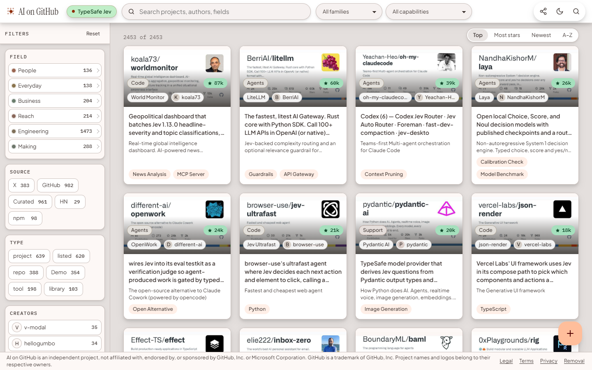

# Abbas Shaheer

I build products with AI agents, and the tools to see and steer what they do.

 

## What I have built

<table>
<tr>
<td width="34%" valign="top">

### [Agent on Browser](https://github.com/syedabbasshaheer-art/browser-agent)

See your project as a board in your browser, and steer your AI agent from it. A plugin for Claude Code.

**Open source, MIT** · [repository](https://github.com/syedabbasshaheer-art/browser-agent)

</td>
<td width="33%" valign="top">

### [AI on GitHub](https://aiongithub.com)

A catalogue of what people are building with AI, sorted by what each project is for. More than 2,400 projects.

**Live** · [aiongithub.com](https://aiongithub.com)

</td>
<td width="33%" valign="top">

### [NCERT Shorts](https://ncertshorts.com)

Class X Science, revised fast or studied deep. Every topic has more than one way in, with a study buddy beside it.

**Live** · [ncertshorts.com](https://ncertshorts.com)

</td>
</tr>
</table>

## How I work

- Measure before you automate.
- Quality is bought upstream.
- Done needs proof: a thing is finished when someone has written down what they observed.

## Elsewhere

[abbasshaheer-site.vercel.app](https://abbasshaheer-site.vercel.app) — notes and beliefs
