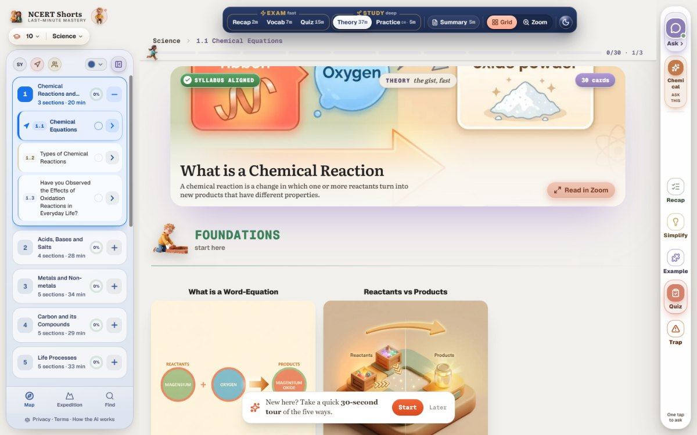
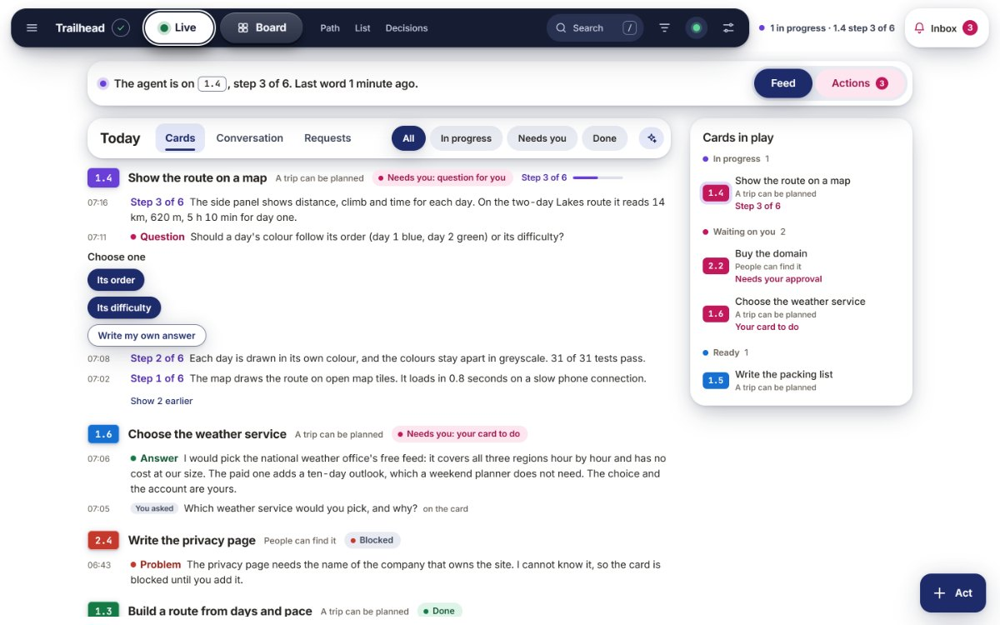
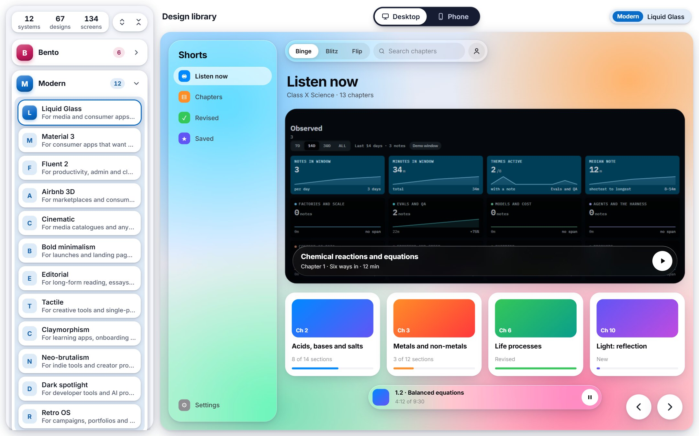
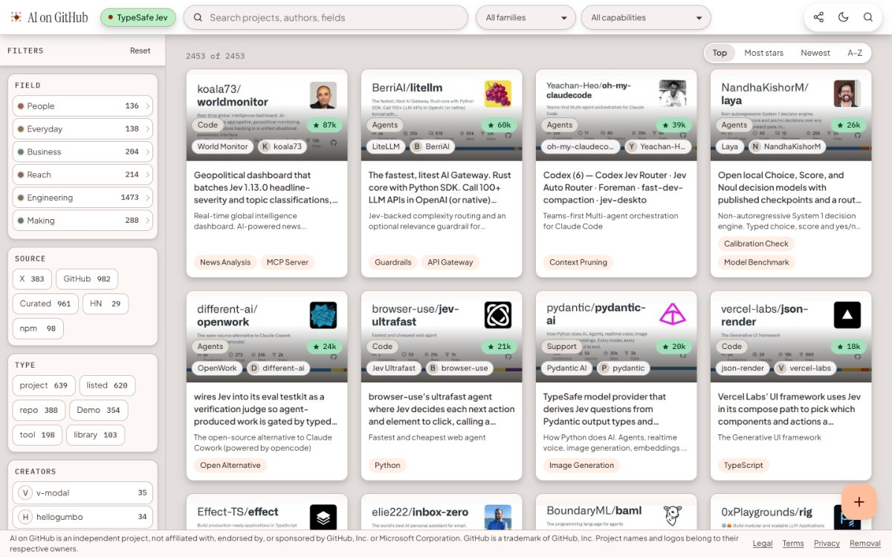

# Abbas Shaheer

I make software, mostly for my personal use. Each piece takes something large and makes it easy to see and choose from: a textbook chapter, an agent's work, a set of design systems, the AI projects people have shipped.

<table>
<tr>
<td width="50%" valign="top">

**[NCERT Shorts](https://github.com/syedabbasshaheer-art/ncertshorts)** 
The NCERT textbook, one topic at a time, in several forms: a two-minute recap, the key words, a quiz, the full theory in pictures, and a study assistant. 
Class X Science &nbsp;·&nbsp; [ncertshorts.com](https://ncertshorts.com)

</td>
<td width="50%" valign="top">

**[Agent on Browser](https://github.com/syedabbasshaheer-art/browser-agent)** 
A Claude Code plugin that shows a project as a page in the browser: the plan, what the agent is doing, and what it is waiting for. 
Open source, MIT

</td>
</tr>
<tr>
<td width="50%" valign="top">

**[Design library](https://github.com/syedabbasshaheer-art/design-library)** 
Sixty-seven working designs in twelve systems, each at desktop and phone width, for choosing the shape of a screen before building it. 
[design.abbasshaheer.com](https://design.abbasshaheer.com)

</td>
<td width="50%" valign="top">

**[AI on GitHub](https://github.com/syedabbasshaheer-art/aiongithub)** 
A catalogue of 2,453 shipped AI projects, each described in one sentence and filed by what it is for. 
[aiongithub.com](https://aiongithub.com)

</td>
</tr>
</table>

Agent on Browser is open source. The code of the other three is private; their repositories describe each product and take reports.

## Beliefs

1. Every new endeavour should begin with two questions: What is the source of truth? What is the best version of this?
2. The highest form of progress is removing the need for repeated correction.
3. Complexity must justify itself through the leverage it creates.
4. Product and distribution are neither substitutes nor competitors for primacy. Distribution determines which capability is consequential. Its best use is as a lever for hypothesis testing.
5. Abstractions and metrics are only useful if they preserve what matters.
6. If you want to separate doers from talkers, ask about the scope of their work. Only precision gets released.
7. Adopt a principle if it survives across domains.
8. Strategy is elimination in pursuit of the ‘one path’. Execution is enforcement of incentives towards that path.
9. Design your company around the experience it intends to deliver.
10. When selling, show that the value of a financial relationship exceeds the sum of its transaction costs.

[abbasshaheer.com](https://abbasshaheer.com)
