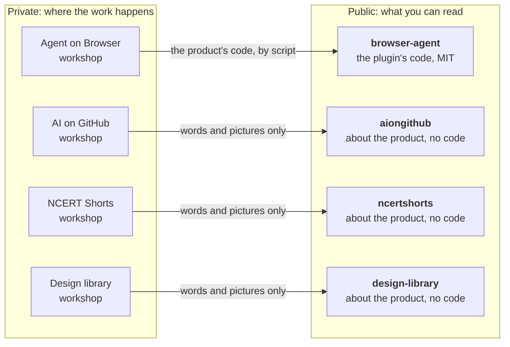

<div align="center">

# Abbas Shaheer

### I build products with AI agents, and the tools to see and steer what they do.

[Agent on Browser](#agent-on-browser) &nbsp;·&nbsp; [AI on GitHub](#ai-on-github) &nbsp;·&nbsp; [NCERT Shorts](#ncert-shorts) &nbsp;·&nbsp; [Design library](#design-library) &nbsp;·&nbsp; [How I work](#how-i-work)

</div>

<br>

## Four products

| | What it is | For | Status | Code |
|---|---|---|---|---|
| **[Agent on Browser](https://github.com/syedabbasshaheer-art/browser-agent)** | Your project as a board in the browser, and a way to steer your AI agent from it | Anyone running a project with an AI agent | Released, updated often | **Open source, MIT** |
| **[AI on GitHub](https://aiongithub.com)** | A catalogue of shipped AI projects, filed by what each one is for | Anyone about to build something with AI | Live, 2,453 projects | Proprietary |
| **[NCERT Shorts](https://ncertshorts.com)** | Every topic of the textbook, with more than one way in | Students of Classes 9 to 12 | Live, Class X Science | Proprietary |
| **[Design library](https://design.abbasshaheer.com)** | Whole screens you can open and run, to pick the shape of a product before building it | Anyone designing a new product screen | Live, 67 designs | Proprietary |

<br>

## Agent on Browser

<a href="https://github.com/syedabbasshaheer-art/browser-agent"></a>

**An hour into a build, the terminal holds four hundred lines and you are scrolling to answer three questions: what is finished, what is it doing right now, and is it waiting for me?** Agent on Browser puts those three answers on one page and keeps them there. You read the plan as goals and cards, answer the agent's questions with one press, and a card closes only with a written line saying what was observed.

It is a plugin for Claude Code. One line installs it and opens your board:

```bash
claude plugin install browser-agent --marketplace syedabbasshaheer-art/browser-agent --scope project; claude "set up my board"
```

**Open source, MIT** &nbsp;·&nbsp; [Repository](https://github.com/syedabbasshaheer-art/browser-agent) &nbsp;·&nbsp; [What changed](https://github.com/syedabbasshaheer-art/browser-agent/blob/main/CHANGELOG.md)

<br>

## AI on GitHub

<a href="https://aiongithub.com"></a>

**Thousands of AI projects ship every month, and a list of names tells you nothing.** AI on GitHub opens each project, describes it in one plain sentence and files it by the job it does and the parts it is built from, so that one question is quick to answer: what already exists for the thing I am trying to build?

On a desktop it is a grid to compare. On a phone it is one project per screen to judge.

**Live** &nbsp;·&nbsp; [aiongithub.com](https://aiongithub.com) &nbsp;·&nbsp; [About it, and where to send requests](https://github.com/syedabbasshaheer-art/aiongithub)

<br>

## NCERT Shorts

<a href="https://ncertshorts.com"></a>

**A student with the exam tomorrow and a student who is lost need different things from the same chapter.** NCERT Shorts gives every topic more than one way in: a two-minute recap, the vocabulary, a quiz, the full theory as picture cards, practice, and a study buddy that answers about the page you are on.

Class X Science is live, all 13 chapters. Classes 9 to 12 follow.

**Live** &nbsp;·&nbsp; [ncertshorts.com](https://ncertshorts.com) &nbsp;·&nbsp; [About it, and where to send corrections](https://github.com/syedabbasshaheer-art/ncertshorts)

<br>

## Design library

<a href="https://design.abbasshaheer.com"></a>

**Every new product screen starts with the same four questions: what shape is it, which parts does it need, how are they arranged, and what happens when someone touches it.** The Design library answers them with whole screens you can open and run, at desktop and phone width: 12 systems and 67 designs, from feeds, boards and checkouts to the design languages that lead in 2026, such as Apple's Liquid Glass and Google's Material 3 Expressive.

Hover any design to read what it is for. Switch to Phone to see a whole system side by side.

**Live** &nbsp;·&nbsp; [design.abbasshaheer.com](https://design.abbasshaheer.com) &nbsp;·&nbsp; [About it, and where to send requests](https://github.com/syedabbasshaheer-art/design-library)

<br>

## How the repositories are arranged

Each product has a private repository where the work happens, and a public one that a visitor can read.



| | Open source | Proprietary |
|---|---|---|
| **Which** | Agent on Browser | AI on GitHub, NCERT Shorts, Design library |
| **The public repository holds** | The product's code, its tests and its guide | What the product is, how to use it, and where to send requests |
| **You may** | Use it, change it and pass it on, under MIT | Use the product on its own site, under its terms |

<br>

## How I work

- **Measure before you automate.** Put a clock on the loop you run all day before you try to make it faster.
- **Quality is bought upstream.** A good first draft costs less than any number of repairs.
- **Done needs proof.** A thing is finished when someone has written down what they observed.

<br>

<div align="center">
<sub><a href="https://abbasshaheer.com">Notes and beliefs</a></sub>
</div>
